# Silhouette

**Silhouette helps a household with a low or moderate income in California find out, in about a minute, which public benefits it may qualify for, and then makes the answer sharper with a paystub or a W-2.**

Exact values never leave the device. A cloud model only ever receives a *silhouette* of the document: every number, date and unknown word is replaced by a placeholder such as `N12`, `D3` or `W4`. The model answers with those ids, and the device puts the real values back.

A web app and a native iOS app, built on one shared contract. Firebase AI Logic runs each model task either on the device's own model (Chrome's built-in model on the web, Apple's on-device model on iOS) or on Gemini in the cloud. An Android port of the same contract exists as code but has never run a real model, so it is not part of what is shown here. A deterministic rule engine on the device decides eligibility; models only point, explain and search.

<p>
  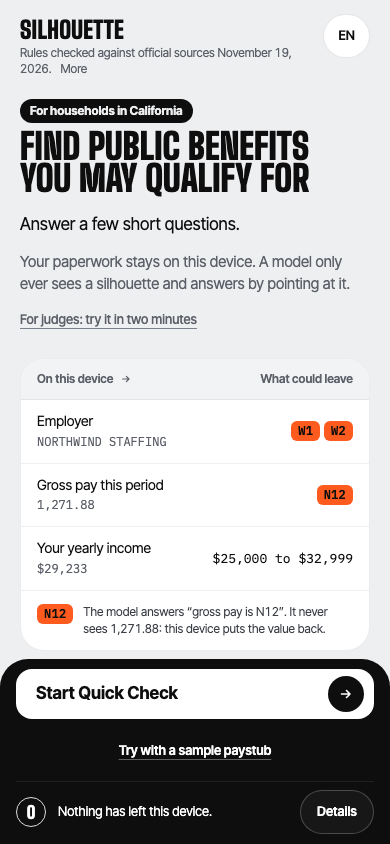
  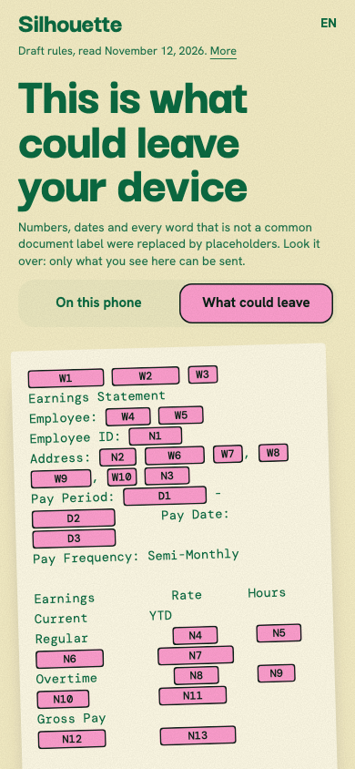
  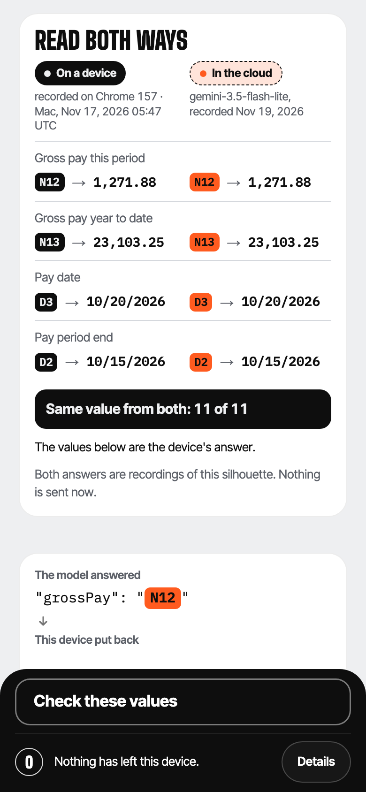
  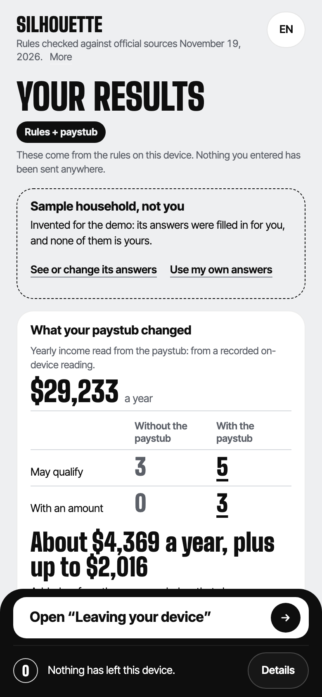
</p>

<p>
  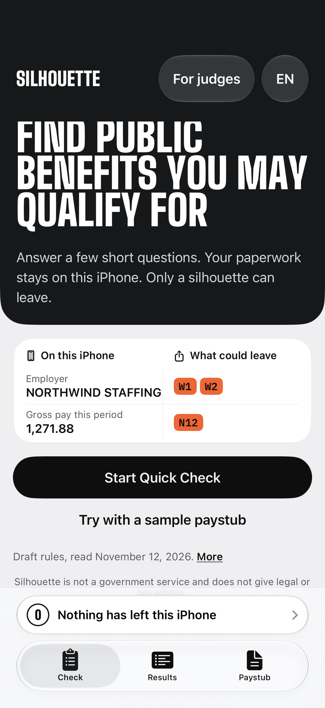
  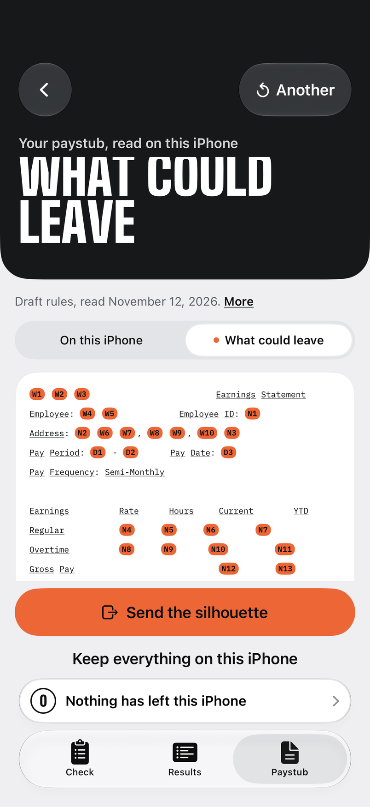
  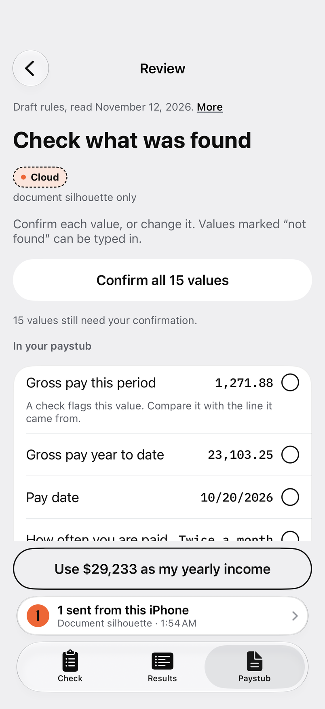
  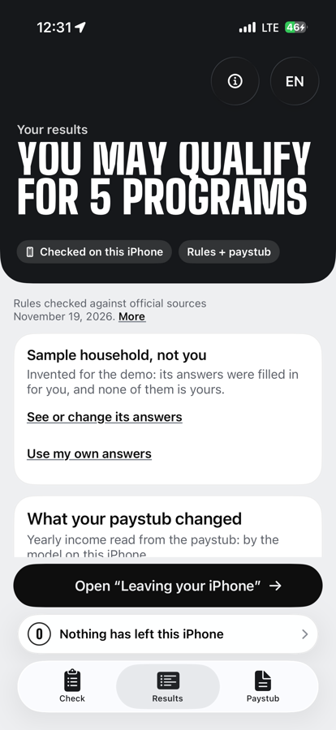
</p>

The same flow as a native SwiftUI app. The start screen is a simulator capture; the other three are from a real iPhone 17 Pro on 2026-11-24: the sample paystub read on the phone at that moment by Apple's on-device model through Firebase AI Logic, next to the cloud's recorded answer to the same silhouette.

### Try it

**Hosted demo: [silhouette-hybrid.web.app](https://silhouette-hybrid.web.app/#/judges)** opens on **Run all three steps**. One press reads an invented household's sample paystub both ways, on screen: first on a device (on this device now when Chrome's on-device model is ready, otherwise the on-device model's answer recorded in Chrome on a Mac), then in the cloud (Firebase AI Logic's answer to the same silhouette, recorded with the exact request). The review then shows the two answers side by side, value by value ("Same value from both"), uses the device's, and the results open with what the paystub changed: without and with it, and the yearly amounts the rules found. Nothing is sent on this path. The three steps are there one at a time too, and **Send** reads the silhouette live. "Leaving your device" says in plain words whether anything left, and each request opens on the silhouette that left; the exact JSON is folded under "For developers". Everything in it is invented. [`#/tasks`](https://silhouette-hybrid.web.app/#/tasks) shows why each task runs where it does, in measured figures, how the routing is enforced, and the Remote Config values in use.

<!-- VIDEO_URL: replace this comment with the demo video link at release -->
**Video: added at release.**

To run it locally (Node 22 or later):

```bash
cd web && npm install && npm run dev
# open http://localhost:5173/#/judges : three steps, one button each
```

Everything except cloud requests works without any Firebase setup, including the bundled sample paystub (see [Run it locally](#run-it-locally)).

---

## Contents

- [Who it is for](#who-it-is-for)
- [How it works](#how-it-works)
- [Hybrid inference: which task runs where](#hybrid-inference-which-task-runs-where)
- [Pointer extraction](#pointer-extraction)
- [Evidence](#evidence)
- [What is different](#what-is-different)
- [Safety details](#safety-details)
- [Platform status](#platform-status)
- [Run it locally](#run-it-locally)
- [Repository layout](#repository-layout)
- [Limits and what is next](#limits-and-what-is-next)
- [Architecture (separate page)](docs/ARCHITECTURE.md)

## Who it is for

A person with a low or moderate income who is not sure which tax credits and discounts apply to their household. Finding out usually means reading program rules one by one, and the most accurate answer depends on exact figures from documents such as paystubs. Those figures, together with names, addresses and household details, are exactly what a person should not have to hand to a cloud service to get an answer.

Silhouette answers from rules on the device, asks for a document only when it would change a result, and never sends the document's values anywhere.

**Programs covered today.** The app ships a California rule pack with seven real programs:

- federal Earned Income Tax Credit (EITC)
- California Earned Income Tax Credit (CalEITC)
- Young Child Tax Credit
- CalFresh
- California LifeLine
- CARE
- FERA

Every limit and amount was read from the agencies' own publications on 2026-11-12, with a source audit of verbatim quotes ([`shared/rulepacks/us-ca/SOURCES.md`](shared/rulepacks/us-ca/SOURCES.md)). On 2026-11-19 every source was opened again and each number compared with it: all 84 limits and amounts, the rates and the ages match, and one rule was corrected (married filing separately with a child is "Possible" for the three tax credits, as the IRS and the FTB allow). Every screen says when the rules were checked, results say "may qualify" and never more, and every program page links its official sources with the date they were checked. Silhouette is not a government service, is not affiliated with any agency, and is not legal or tax advice.

## How it works

**1. Quick Check, on the device.** Fourteen short questions, one per screen. Every question can be skipped. Five sensitive ones (tax filing status, taxpayer id type, investment income, an elderly or disabled household member, a household member eligible for CalFresh) say that the answer never leaves the device.

**2. Results from rules, not a model.** The rule engine sorts each program into *may qualify*, *possible*, *depends on a skipped answer* or *probably not*. A program page lists every criterion with its state, and where a limit decided it, the limit and the person's value. The bar at the bottom counts what has left the device: 0.

<p>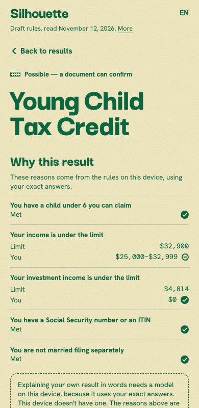</p>

**3. Add a paystub or a W-2.** A "possible" result depends on the exact income, which a document can settle. A paystub gives the year-to-date pay, from which the year is worked out; a Form W-2 states the year's wages (box 1), and the W-2s of one year from several employers are added together. The document can be a text PDF, pasted text, a photo (read only by an on-device model), typed numbers, or a bundled sample; a W-2 is recognised by its own title. The file is read on the device and not uploaded.

<p>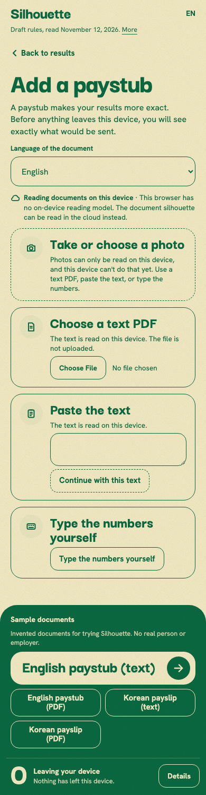</p>

**4. The silhouette preview: what could leave.** Before anything can be sent, the person sees the document as it reads on the device and, one tap away, exactly what could leave. Any word still visible can be hidden too.

<p>
  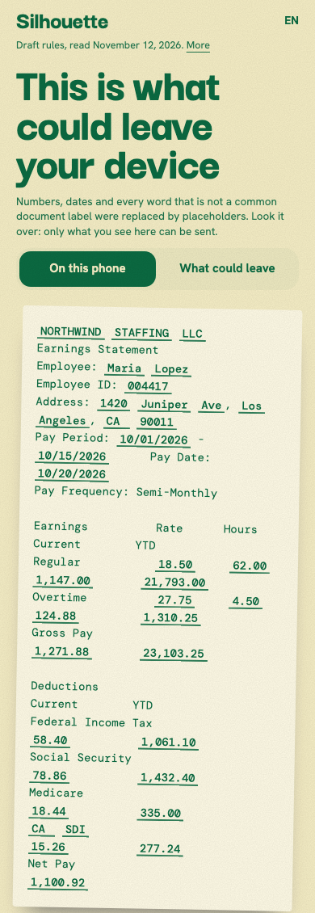
  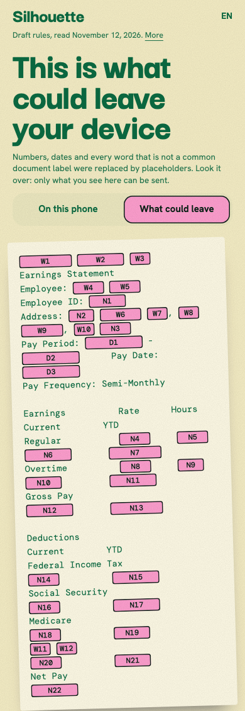
</p>

**5. Review, confirm, sharper results.** The review opens with the reading's own answer: the model answered `"grossPay": "N12"`, and this device put back `1,271.88`. Each value found is shown next to the line it came from, to confirm or change. A badge says where it was read ("Cloud · document silhouette only" here: a live reading in Safari on an iPhone, a browser without an on-device model). Deterministic checks and annualization turn the confirmed document into a yearly income, and the results update: they say "Rules + paystub" (or W-2), how the document was read, and how the yearly income was worked out, with a link to change it.

<p>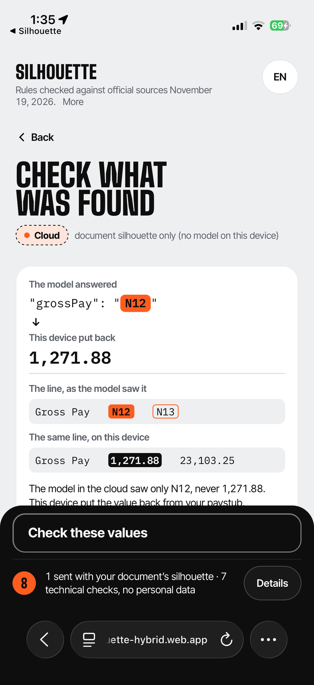</p>

**6. "Leaving your device".** Before a request that may leave, the app lists what it carries and shows the exact request body. Afterwards the record says in plain words what left: a headline ("Nothing has left this device", or how many requests left and that none of them carried your names, numbers or dates), then each request with what left (for a document, the silhouette as chips) and what was kept on the device, and the exact request body folded under "For developers". Every answer written on the device is listed as "kept".

<p>
  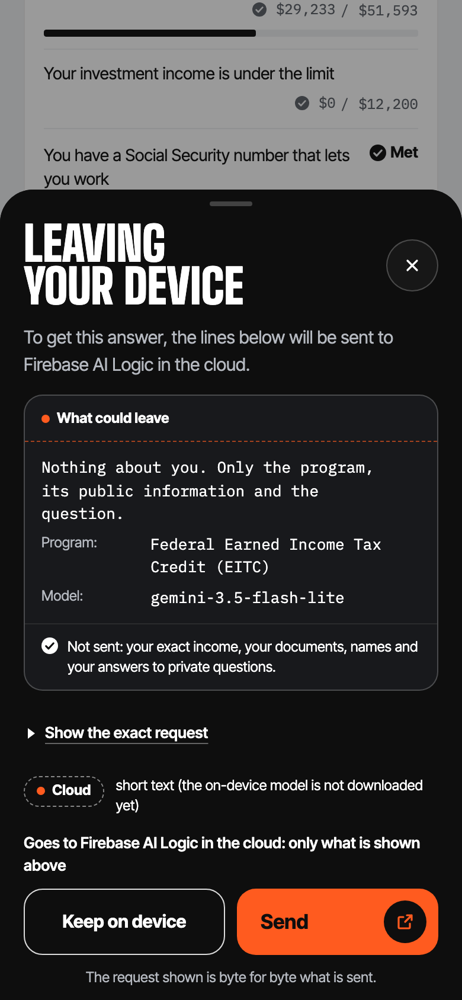
  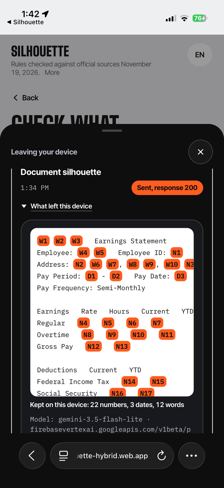
</p>

## Hybrid inference: which task runs where

Every model task, its mode, its input type and the reason shown to the person come from one file, [`shared/routing.json`](shared/routing.json). The labels are the English copy in [`shared/copy/en.json`](shared/copy/en.json).

| Task | Mode | Input | Reason shown |
|---|---|---|---|
| `document.photo.read` | ONLY_ON_DEVICE | Raw | photo never leaves |
| `explain.personal` | ONLY_ON_DEVICE | Raw, Public | your result stays on this device |
| `ask.freeText` | ONLY_ON_DEVICE | Raw | typed text may be personal |
| `document.pointer.extract` | PREFER_ON_DEVICE | Skeleton | document silhouette only |
| `explain.short` | PREFER_ON_DEVICE | Public | short text |
| `ask.chip` | PREFER_ON_DEVICE | Public | prepared question |
| `explain.long` | PREFER_IN_CLOUD | Public | long text or language not available on device |
| `program.currentStatus` | ONLY_IN_CLOUD + Google Search | Public | needs current info |
| `discover.leads` | ONLY_IN_CLOUD + Google Search | Generalized | needs current info |
| `nearby.help` | ONLY_IN_CLOUD + Google Maps | Generalized | needs places |
| `readAloud` | ONLY_IN_CLOUD, speech | Generalized, Public | read aloud |

The last four rows (search grounding, places and read aloud) are built on the web only and switched off by default through Remote Config: the hosted app does not use them.

Five more steps use no model at all: `validate`, `annualize`, `generalize`, `verdict` and `application.prefill` (mode `NONE`).

**The type rule.** Every value is one of four types ([`shared/DATA_TYPES.md`](shared/DATA_TYPES.md)): `Raw` (document text, exact amounts, names, private answers, typed questions, and any verdict computed from them), `Skeleton` (the document silhouette), `Generalized` (an income band, household size, county) and `Public` (program facts). `Raw` only ever reaches `ONLY_ON_DEVICE` calls and deterministic code. Every cloud-capable call takes `Skeleton`, `Generalized` or `Public` only, and on each platform passing a `Raw` value to one does not compile. So when a `PREFER_ON_DEVICE` task falls back to the cloud, it sends nothing that was not already safe to send. Only two deterministic functions turn `Raw` into a cloud-safe type: the Skeletonizer and the Generalizer.

**Badge and reason on every answer.** Each model result on screen says where it was written ("On this device" or "Cloud") and why, using the reason above. For explanations the reason also names what decided the route: the length against a Remote Config limit (80 words by default), or the language.

**Who picks device or cloud: Firebase AI Logic.** For the tasks whose input is already safe to send, the SDK places each request. On the web every task gets its own model in its routing mode (`getGenerativeModel` with `PREFER_ON_DEVICE`, `PREFER_IN_CLOUD` or `ONLY_IN_CLOUD`), and the badge shows the `inferenceSource` the SDK reports ([`web/src/ai/firebase.ts`](web/src/ai/firebase.ts)). On iOS the SDK's `HybridModel` puts Apple's on-device model first and Gemini second (cloud first for `PREFER_IN_CLOUD`), and the badge follows the model the reply names ([`ios/Silhouette/AI/FirebaseServices.swift`](ios/Silhouette/AI/FirebaseServices.swift)). The apps add only what the SDK does not do: `ONLY_ON_DEVICE` is guarded (below), a device answer that fails the deterministic checks is sent to the cloud once (the SDK treats it as a success), App Check runs only when a request is handed to the cloud, and the reading of a document on the device in parts stays with the app, because each part has its own constraint.

**Without an on-device model.** This is the path most people will see, and it is complete:

- the document silhouette is read in the cloud, after the person presses Send;
- every value can be typed by hand instead ("Keep everything on this device");
- the bundled sample paystubs are filled from a fixed answer key when there is no network and no device model, labelled "Sample answers, no AI";
- the explanation of the person's own result is replaced by the rule engine's reasons as plain lines, and typed questions are not offered.

## Pointer extraction

The Skeletonizer ([`shared/skeleton/SPEC.md`](shared/skeleton/SPEC.md)) is deny by default: a word survives only if it is on a short list of generic payroll and tax vocabulary. Three lines of the bundled synthetic sample, on the device and in the silhouette:

```text
On the device                                   Silhouette (what could leave)
Pay Period: 10/01/2026 - 10/15/2026             Pay Period: ⟦D1⟧ - ⟦D2⟧
Gross Pay        1,271.88      23,103.25        Gross Pay        ⟦N12⟧      ⟦N13⟧
Net Pay          1,100.92                       Net Pay          ⟦N22⟧
```

The model is asked which placeholder holds which field and answers with ids and closed choices only ([`shared/samples/answers.json`](shared/samples/answers.json)):

```json
{ "periodStart": "D1", "periodEnd": "D2", "grossPay": "N12", "ytdGross": "N13",
  "netPay": "N22", "payFrequency": "semimonthly" }
```

The placeholder map stays on the device as `Raw`. The Rehydrator looks up `N12` and gets `1,271.88`. A reference to an id that does not exist, or of the wrong kind, is dropped and shown as "not found". The model cannot write a value, so it cannot leak one or invent one.

## Evidence

Each figure below is copied from a file in this repository, with its date.

**Documents it had never seen, 2026-11-19** ([`web/eval/heldout/`](web/eval/heldout/), [`web/eval/heldout-2/`](web/eval/heldout-2/), results in [`web/eval/results/heldout/`](web/eval/results/heldout/)). Apart from the iPhone run that follows them, the figures below were measured on documents the prompts and checks were tuned on. These sets were written independently of the prompts, word lists, rules and tuning documents, and committed before the app read them: the commit that adds each set's `FROZEN.md` (with every file's SHA-256) comes before the commit with its results: paystubs `83dccc5` (2026-11-19 06:25 UTC) before `9baee3d` (06:39 UTC); second W-2 set `35ca134` (07:03 UTC) before `17520b5` (07:10 UTC). Each set was written by a separate writer working only from public descriptions of US paystubs and Form W-2, with no access to the system's prompts, word lists, rules, code or the documents it was tuned on. The same app code read them in the cloud and in Chrome 157 with its on-device model (device first, the checks, one cloud retry of the same silhouette).

| Never-seen documents | In the cloud | On the device first |
|---|---|---|
| 24 paystubs in 12 layouts: a wrong yearly-income value reached the person | **0 of 24** | **0 of 24** |
| Same paystubs: every yearly-income input right (the others left for the person to type) | 22 of 24 | 17 of 24 |
| The device's first answer had a wrong yearly-income input | | 12 of 24, every one caught before it was shown (read again in the cloud, or the value left out to type); 11 of 24 read again in the cloud |
| Form W-2, first set of 6: box 1 wrong | 2 of 6 | 3 of 6 |
| Form W-2, second set of 12, after the first change (v1.37): box 1 wrong | 2 of 12 | 1 of 12 |
| Request bodies containing a name, date or amount of their document | 0 of 42 | |

Form W-2 was the weak part: box 1 was read from a box number, a street number or a neighbouring box. The checks were changed after each W-2 set ([`shared/CHANGELOG.md`](shared/CHANGELOG.md) v1.37, v1.38): a box answered from a number without cents, or boxes 1 and 2 that do not fit together, are now left out for the person to type. The 18 stored cloud answers, checked again with those rules and no new model call ([`web/eval/heldout-recheck.mjs`](web/eval/heldout-recheck.mjs)): box 1 right on 10, left out on 8, wrong on 0. That last line comes after seeing the sets, so neither W-2 set counts as held out any more ([`FROZEN.md`](web/eval/heldout/FROZEN.md) says so); the 24 paystubs still do. Names and deductions were weaker than the yearly-income inputs (names with "&" were cut short); neither feeds a result. `#/tasks` shows these figures and recounts them in the browser from the files.

**Paystubs it had never seen, on an iPhone 17 Pro, 2026-11-24** ([`web/eval/heldout-3/`](web/eval/heldout-3/); run file and details in [`ios/eval/on-device/README.md`](ios/eval/on-device/README.md#the-measurement-2026-11-24)). A third set of 24 paystubs in 12 layouts, 1,558 to 3,496 characters each, written the same way and frozen before the app read it (`049b608`, 2026-11-23 19:09 UTC, before the results in `059175f`, 2026-11-24 04:12 UTC), read once on the phone (iOS 26.5.2) the way the app reads a document: Apple's on-device model first, the checks, and one cloud retry of the same silhouette when they fail.

| Never-seen paystubs on the iPhone | |
|---|---|
| The iPhone's first answer had a wrong yearly-income input | 22 of 24 |
| Stopped by the checks before anything was shown, read again in the cloud from the silhouette | **22 of 22** |
| Answered on the iPhone to the end | 2 of 24 |
| Every yearly-income input right in what the person is shown | 19 of 24 |
| A wrong yearly-income value reached the person | **1 of 24**, from the cloud's answer, with the review screen's sum check warning |

On real-length paystubs, Apple's on-device model on iOS 26.5 mostly pointed at the wrong placeholder (an employee ID, a ZIP code); on the shorter documents the checks were tuned on, it had every yearly-income input right in 15 of 15 readings (below). The deterministic checks are what keep the device-first path safe: a wrong first answer never reached the screen, and the cloud that read it again saw only the silhouette. The one miss was the cloud's: gross pay taken from the neighbouring column of a summary table. Four paystubs write dates as `30-Sep-26`, which the silhouette does not hold as dates; they were left for the person to type. Nothing was changed because of what this set showed.

**Cloud extraction, 2026-11-12** ([`web/eval/results/summary.md`](web/eval/results/summary.md)). Synthetic paystubs with known answers, real calls to `gemini-3.5-flash-lite` through the app's own code path, two runs (`v15p4`, `v15p4r`):

- all fields right on 30 of 30 English paystubs in ten layouts, in both runs; gross pay, net pay, year to date and pay frequency at 100 % recall and 0 % wrong;
- all fields right on 8 of 8 paystubs of an eleventh layout with names that contain label words and dates written with month names;
- the first variant of the prompt, for comparison, had all fields right on 0 of 30.

The prompt measured is v4. The cloud prompt in use (v5) is v4's text word for word ([`shared/CHANGELOG.md`](shared/CHANGELOG.md), v1.17).

**Leak check, same runs** ([`web/eval/results/v15p4.json`](web/eval/results/v15p4.json), field `leakCheck`). No name, date or amount printed in a document appeared in any of the 39 request bodies sent for 38 documents. In the browser tests, a canary test fails if any string listed in [`shared/fixtures/canary/`](shared/fixtures/canary/) appears in any outgoing URL, header or body.

**On-device runs in Chrome 157, 2026-11-16 to 2026-11-17** ([`web/eval/results/on-device/README.md`](web/eval/results/on-device/README.md)). Seven recorded runs of the app's on-device check on macOS, each a JSON file in that folder or its `history/`. They use the same five check paystubs the checks were changed against between runs; the never-seen sets above are the held-out measure. A "reading" is one paystub read once; a case that ended up in the cloud counts as a cloud run.

| Run | What changed before it | Answered on the device | Readings with a wrong value reaching the person |
|---|---|---|---|
| 1 (baseline) | One request, no check of the answer | 14 of 14 | not recorded; 37 of 60 fields right, nothing checked the rest |
| 2 | Deterministic check; a failed answer is read once in the cloud | 9 of 14 | 0 of 5 |
| 3 | Reading in parts with a strict response constraint | 13 of 14 | 3 of 5 |
| 4 | Year-to-date rules; gross pay asked again when only it fails | 14 of 14 | 1 of 5 |
| 5 | One placeholder per field; each paystub read three times | 24 of 24 | 2 of 15 |
| 6 | A name cut short is left out as not read | 24 of 24 | 0 of 15 |
| 7 (latest) | Hours, rate, net pay and an early pay date are shown only when a check confirms them | 24 of 24 | **0 of 15** |

In the latest run (2026-11-17), all 24 cases ran on the device: 15 paystub readings, two general explanations and four prepared questions in English and Spanish, the explanation of a person's own result, a typed question, and reading a photo of the sample. Every yearly-income input was right in 14 of 15 readings; in the other one a value was not found and left for the person to type, never filled with a wrong one. Median time per paystub: 7.9 s (4.8 to 11.2 s). Replaying every recorded on-device answer, from these runs and from three runs on an iPhone, through the current checks leaves no reading with a wrong value reaching the person (the recomputed table in the same README). Two of these runs are bundled in the app at `#/device-check`, labelled as recordings with their date and machine.

<p>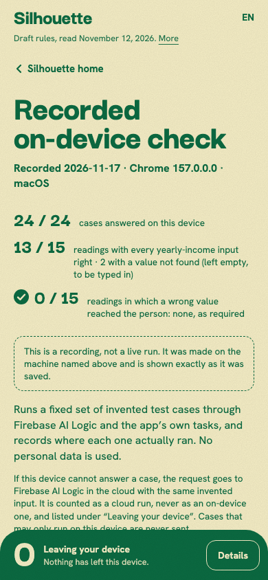</p>

**On-device runs on an iPhone 17 Pro, 2026-11-17 and 2026-11-19** ([`ios/eval/on-device/README.md`](ios/eval/on-device/README.md)). Seven recorded runs of the same check with Apple's on-device model through Firebase AI Logic (iOS 26.5.2), each a JSON file in that folder.

| Run | What changed before it | Answered on the device / in the cloud | Readings with a wrong value reaching the person |
|---|---|---|---|
| 1 (baseline) | The checks as first ported | 12 / 1 of 13 | 3 of 5 |
| 3 | Each paystub read three times | 17 / 6 of 23 | 6 of 15 |
| 5 | Values that feed no result shown only when confirmed; greedy sampling | 20 / 3 of 23 | 0 of 15 |
| 7 (latest, 2026-11-19) | The app at the current contract (v1.42) | **23 / 0 of 23** | **0 of 15** |

In the latest run every case was answered on the phone and nothing went to the cloud, and every yearly-income input was right in 15 of 15 readings. In the 11-17 runs Apple's model refused one of the five paystubs before answering ("unsupported language", recorded in the run file with the error), and that paystub was read in the cloud as a silhouette; on 11-19 it was answered on the device in all three repetitions. Explanations and questions ran on the phone in 1.4 to 2.8 s each; a paystub took 8.3 s (median, 6.1 to 13.0 s) on the device. The phone's model takes text only, so the photo case does not run there and is not counted. The price of showing only confirmed values on this model: in the latest run names were marked "not read" in 12 of 15 readings, hours, rate and deductions in 9 of 15.

**Explanations, 2026-11-14** ([`web/eval/results/answers-v5.md`](web/eval/results/answers-v5.md)). 12 real cloud replies (explanations and prepared questions, English and Spanish): none said anything about the person, and the check on model text blocked none.

**Rule pack.** The engine reproduces all 189 results of 27 households worked out by hand ([`shared/rulepacks/us-ca/README.md`](shared/rulepacks/us-ca/README.md)).

**Tests, as of 2026-11-19.** Web: 1,142 unit tests, including every shared conformance fixture, and 286 browser test runs (Playwright, each test on a desktop and a phone viewport). Continuous integration runs only the 30 shared contract tests, on pushes that change `shared/`; the web tests are run locally. Shared reference implementation: 30 tests. iOS (as of 2026-11-17): 120 package tests, including the shared fixtures, and 13 UI tests.

**Not verified yet.**

- Current information and other help (Google Search grounding), help nearby (Google Maps grounding) and read aloud are built behind Remote Config flags that are off by default, and are tested only with replies faked in the shapes the API documents.
- No on-device run has been made on Android.
- On iPhone, in the 11-17 runs one of the five check paystubs was refused by Apple's model as an unsupported language and read in the cloud instead; in the 11-19 runs the same paystub was answered on the device. The cause is open.

## What is different

- **One contract, three native apps.** [`shared/`](shared/README.md) holds the specifications, a reference implementation in plain Node and conformance fixtures. Web (TypeScript), Android (Kotlin) and iOS (Swift) each implement the Skeletonizer, the Rehydrator, the Generalizer and the rule engine natively and must reproduce the fixtures byte for byte.
- **The model never sees values.** It answers with placeholder ids and closed choices. Values exist only on the device.
- **Checks that only reject.** On-device answers pass deterministic checks before a person sees them. The checks may reject an answer, leave a field out, or ask the device again. They never pick, extend or fill in a value ([`shared/validation/DEVICE_READING.md`](shared/validation/DEVICE_READING.md)).
- **No model decides eligibility.** Verdicts come from a three-valued rule engine reading a versioned rule pack. Model text that states a result ("you qualify") is blocked before it is shown ([`shared/prompts/OUTPUT_CHECKS.md`](shared/prompts/OUTPUT_CHECKS.md)).
- **Shown before, recorded after.** On the web, the request body shown before sending is the string that is sent and the one kept in the record, byte for byte. Requests are recorded before they leave ("attempted") and then marked sent or failed.

## Safety details

**`ONLY_ON_DEVICE` really stays on the device.** In a browser without Chrome's Prompt API, Firebase AI Logic 3.1 (in the Firebase JS SDK 13.3) sends a request to the cloud whatever its inference mode, `ONLY_ON_DEVICE` included. Two guards stop this:

1. Every `ONLY_ON_DEVICE` task ([`web/src/ai/on-device.ts`](web/src/ai/on-device.ts)) stops with a typed error before any SDK call unless the on-device model reports `available`.
2. The network monitor ([`web/src/data/net-monitor.ts`](web/src/data/net-monitor.ts)) lets a request reach Firebase AI Logic only when a cloud-capable task registered it just before. Anything else is blocked and recorded as blocked.

Both are tested ([`web/src/ai/only-on-device.test.ts`](web/src/ai/only-on-device.test.ts), [`web/e2e/dev/only-on-device.spec.ts`](web/e2e/dev/only-on-device.spec.ts)).

**Nothing before it is needed.** In a Chrome that has the built-in model, the whole two-minute path makes no request to any other origin: requests that run on the device use a Firebase app without App Check, and App Check and reCAPTCHA start only when a request is about to go to the cloud. A browser test asserts this on the network under the hosting build and policy ([`web/e2e/hosting/device-only.spec.ts`](web/e2e/hosting/device-only.spec.ts)). A first cloud Send makes eight requests the page can see, one of them with the silhouette; they are listed in [`web/README.md`](web/README.md) under "What leaves, and when". A cloud request is sent only with a limited-use App Check token: if the token exchange fails, nothing is sent.

**App Check.** Cloud calls need App Check: reCAPTCHA Enterprise on the web, with limited-use tokens for Firebase AI Logic; Play Integrity on Android and App Attest on iOS for release builds. Debug tokens are for local development only. A build check fails if a production web bundle contains the debug-token code path or any value from a local env file.

**Content security policy.** [`firebase.json`](firebase.json) allows connections only to the four Firebase endpoints the app calls (AI Logic, App Check, Installations, Remote Config) and reCAPTCHA, with no font or analytics hosts. A browser test runs the app under that policy and fails on any violation.

**Encrypted local storage.** Answers and documents are stored encrypted with AES-256-GCM: on the web with a non-extractable WebCrypto key in IndexedDB, on Android with a Keystore key, on iOS with a Keychain key.

**Delete everything.** One action erases the encrypted store and its key, and on the web also the Firebase SDK's own App Check, installation and heartbeat databases. Only the time of deletion is kept, so the app can say the record was deleted.

**Remote Config** is not fetched at start. The first fetch follows the first request the person chose to send, and appears in the record like any other request.

## Platform status

As of 2026-11-24.

| Platform | Contract | Done and verified | Not yet |
|---|---|---|---|
| Web | v1.44 | Reference implementation with the California pack, hosted with App Check (reCAPTCHA Enterprise). Firebase AI Logic places every device-first request (`PREFER_ON_DEVICE`); the one-press path reads the sample both ways and compares the answers. Seven recorded on-device runs in Chrome; real cloud calls in the evaluations and on the hosted app | Search grounding and read aloud are built but switched off |
| iOS | v1.45 | Native SwiftUI app: California pack, the paystub flow, on-device reading in parts with the shared fixtures, explanations through the SDK's `HybridModel`, the on-device check, a held-out run, and the two-minute path in one press: the sample read on this iPhone now (or the iPhone's recorded answer) and then the recorded cloud answer, compared value by value, then what the paystub changed. Seven recorded runs on a real iPhone 17 Pro, the latest with all 23 cases answered on the phone, and one run on 24 never-seen paystubs | Form W-2 as a document on iPhone; a build to install without Xcode |
| Android | v1.18 (behind) | Code only, not part of the submission's judged path. A native Compose port of an earlier contract: California pack, document flow, on-device reading in parts with the shared fixtures, Firebase AI Logic (`firebase-ai` and `firebase-ai-ondevice`). It has been run only against a scripted model: it has never run Gemini Nano or a cloud model | Everything since contract v1.18, the current design, and any run with a real model |

Where each app calls Firebase AI Logic: [`web/src/ai/`](web/src/ai/), [`android/app/src/main/kotlin/app/silhouette/benefits/ai/firebase/`](android/app/src/main/kotlin/app/silhouette/benefits/ai/firebase/), [`ios/Silhouette/AI/`](ios/Silhouette/AI/).

## Run it locally

**Web app** (Node 22 or later), from [`web/README.md`](web/README.md):

```bash
cd web
npm install
npm run dev              # http://localhost:5173
npm test                 # unit tests, including the shared conformance fixtures
npx playwright install chromium
npm run e2e              # browser tests
```

**Contract tests** (no dependencies to install):

```bash
cd shared/reference && npm test
```

**What works without a Firebase project:** the Quick Check, results, the bundled sample documents (offline, from their answer key), manual entry, the rule pack's official information, and on-device reading in a Chrome that has its built-in model ready.

**What needs a Firebase project:** cloud requests. They need Firebase AI Logic enabled with the Gemini Developer API and App Check. The web app's public config is in [`web/src/data/firebase-config.ts`](web/src/data/firebase-config.ts); point it at your own web app, then put a registered App Check debug token in `web/.env.local` (ignored by Git):

```
VITE_APPCHECK_DEBUG_TOKEN=<your registered debug token>
```

**On-device runs:** open `#/device-check` in desktop Chrome with the on-device model installed, run the check, and download the results file ([how a run file is made](web/eval/results/on-device/README.md)).

**Android and iOS:** see [`android/README.md`](android/README.md) and [`ios/README.md`](ios/README.md) for their requirements and test commands.

## Repository layout

| Path | What it holds |
|---|---|
| [`shared/`](shared/README.md) | The contract: data types, routing, specifications, rule packs, prompts, copy, design tokens, conformance fixtures, reference implementation |
| [`web/`](web/README.md) | Web app (TypeScript, React, Vite), its tests and evaluations |
| [`android/`](android/README.md) | Android app (Kotlin, Jetpack Compose) |
| [`ios/`](ios/README.md) | iOS app (Swift, SwiftUI) |
| [`firebase/`](firebase/README.md), [`firebase.json`](firebase.json) | Remote Config template, Firestore rules, hosting headers |
| [`docs/`](docs/ARCHITECTURE.md) | Architecture and these images |

**Contract versions.** The contract is versioned in [`shared/CHANGELOG.md`](shared/CHANGELOG.md), now at v1.45. Every change comes with updated fixtures and an entry that says what changed and why, usually with the measurement that prompted it. Prompts are versioned files; older versions stay for the record, and a Remote Config key picks which bundled version an app uses. Each platform states the contract version it implements.

More detail: [docs/ARCHITECTURE.md](docs/ARCHITECTURE.md).

## Limits and what is next

- CalEITC and the Young Child Tax Credit use tax year 2025 figures because the 2026 figures are not final. The separated-spouse exception for married filing separately is shown as "Possible", because the app does not ask whether the spouses lived apart.
- One jurisdiction. Two document types: paystubs and Form W-2.
- Photos are read only by an on-device model; there is no separate text recognition library.
- The on-device checks have known gaps, listed in [`shared/validation/DEVICE_READING.md`](shared/validation/DEVICE_READING.md) section 9.
- Next: the current design on Android and its recorded on-device run, and the video.

## License

Apache License 2.0. See [LICENSE](LICENSE).

Built with Claude Code and Firebase Agent Skills.
