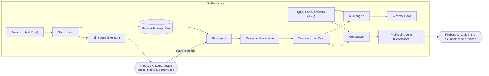
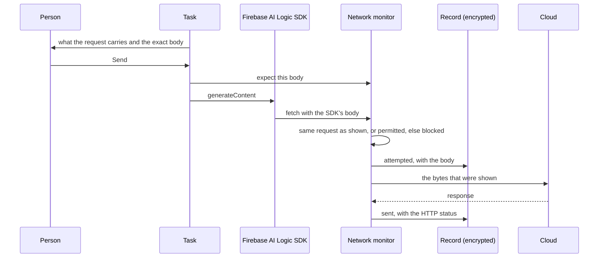
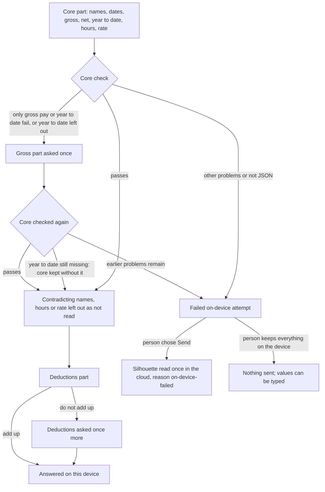

# Silhouette architecture

This page is for an engineer who wants to understand, run or port Silhouette. The product overview is in the [README](../README.md). The normative texts are in [`shared/`](../shared/README.md); where this page and a specification disagree, the specification wins. Contract version described here: **v1.17** ([`shared/CHANGELOG.md`](../shared/CHANGELOG.md)).

1. [Overview](#1-overview)
2. [Data types and the type rule](#2-data-types-and-the-type-rule)
3. [The Skeletonizer and rehydration](#3-the-skeletonizer-and-rehydration)
4. [Routing and the outbound choke point](#4-routing-and-the-outbound-choke-point)
5. [Reading a paystub on the device](#5-reading-a-paystub-on-the-device)
6. [Validation and the yearly income](#6-validation-and-the-yearly-income)
7. [The rule engine and rule packs](#7-the-rule-engine-and-rule-packs)
8. [Checks on model text](#8-checks-on-model-text)
9. [Storage and deletion](#9-storage-and-deletion)
10. [App Check, Remote Config and hosting](#10-app-check-remote-config-and-hosting)
11. [Conformance: how a platform proves it implements the contract](#11-conformance-how-a-platform-proves-it-implements-the-contract)
12. [Known limits](#12-known-limits)

## 1. Overview

Everything the person enters, and every document they add, is `Raw` and stays on the device. Two deterministic functions produce the only person-derived values that may reach a cloud-capable call: the **Skeletonizer** (document to silhouette) and the **Generalizer** (exact profile to bands). A model reads the silhouette and answers with placeholder ids; the device turns ids back into values, checks them, and hands a confirmed yearly income to the rule engine.



The same contract is implemented natively three times:

| | Web | Android | iOS |
|---|---|---|---|
| Language and UI | TypeScript, React, Vite | Kotlin, Jetpack Compose | Swift, SwiftUI |
| Deterministic core | [`web/src/core/`](../web/src/core/) | [`android/core/`](../android/core/) (`:core`, pure JVM) | [`ios/SilhouetteCore/`](../ios/SilhouetteCore/) (Swift package) |
| Firebase AI Logic calls | [`web/src/ai/`](../web/src/ai/) | [`android/app/src/main/kotlin/app/silhouette/benefits/ai/firebase/`](../android/app/src/main/kotlin/app/silhouette/benefits/ai/firebase/) | [`ios/Silhouette/AI/`](../ios/Silhouette/AI/) |
| On-device model | Chrome's built-in model | Gemini Nano (`firebase-ai-ondevice`) | Apple Foundation Models through the SDK |

## 2. Data types and the type rule

Specification: [`shared/DATA_TYPES.md`](../shared/DATA_TYPES.md).

| Type | Examples | May enter a cloud-capable call? |
|---|---|---|
| `Raw` | Document text or photo, exact amounts, names, addresses, answers to sensitive questions, typed questions, the placeholder map, words the person hid, and any verdict computed from these | No |
| `Skeleton` | A document with every number, date and non-allowlisted word replaced by a placeholder | Yes |
| `Generalized` | Income band, household size, child age bands, county, housing status | Yes |
| `Public` | Program names, rule text, program facts, prepared question chips | Yes |

> `Raw` values only ever reach `ONLY_ON_DEVICE` model calls and deterministic code. `PREFER_ON_DEVICE`, `PREFER_IN_CLOUD` and `ONLY_IN_CLOUD` calls accept `Skeleton`, `Generalized` and `Public` only.

**Verdicts are `Raw` too.** A verdict, or the state of one criterion, computed from exact values or private answers can reveal the answer it came from. Since v1.15 the general explanation and the prepared questions carry nothing about the person at all: only the program's name, its public facts and the question. Explaining a person's own result is `explain.personal`, which is `ONLY_ON_DEVICE`.

**Consequence for fallback.** A `PREFER_ON_DEVICE` task already holds cloud-safe input, so the one cloud retry after a failed on-device attempt (`onDeviceFailure` in [`routing.json`](../shared/routing.json)) sends nothing the first attempt could not have sent. `ONLY_ON_DEVICE` tasks never fall back.

### How each platform makes the rule a compile-time property

| Platform | Mechanism |
|---|---|
| Web | [`web/src/core/types.ts`](../web/src/core/types.ts) defines `Raw<T>` (opaque, serializes as `"[Raw]"`), `Skeleton`, `Generalized<T>`, `Public<T>`. Cloud-capable task functions accept only `Skeleton \| Generalized \| Public`; [`web/src/ai/routing.test-d.ts`](../web/src/ai/routing.test-d.ts) proves a `Raw` argument fails to compile. [`web/scripts/check-routing.mjs`](../web/scripts/check-routing.mjs) runs before every typecheck and rejects casts to cloud-safe types, unwrapping `Raw` outside `src/core/` (except the on-device-only tasks), and importing `firebase/ai` outside `src/ai/` |
| Android | `CloudSafe` is sealed; the constructors of `Skeleton` and `Generalized` are internal to `:core`; `Raw` has no serializer and prints as `[Raw]`. Snippets under [`android/core/src/routingProof/`](../android/core/src/routingProof/) must fail to compile for exactly these reasons, and a test compiles each one and checks the diagnostic |
| iOS | Cloud-capable calls take `some CloudSafe`; `Raw` does not conform, prints as `[Raw]`, is not `Codable`, and is readable only inside `SilhouetteCore`. A cloud request is a `CloudRequest` that only the planner builds from cloud-safe values. Probes in [`ios/SilhouetteCore/RoutingProof/`](../ios/SilhouetteCore/RoutingProof/) must, or must not, compile |

## 3. The Skeletonizer and rehydration

Specification: [`shared/skeleton/SPEC.md`](../shared/skeleton/SPEC.md). Pointer schemas: [`shared/schemas/`](../shared/schemas/).

**Deny by default.** The tokenizer keeps a character only if it is on an explicit list of safe characters (whitespace, ASCII punctuation, a few currency and typographic symbols) or belongs to an allowlisted word. Nothing depends on a platform's Unicode property tables, which is what makes byte-identical output possible on three runtimes. Then:

- every date becomes `⟦D{n}⟧` and every number `⟦N{n}⟧`, always;
- a word survives only if it, and every other word of its phrase, is on the allowlist for the document's language plus English ([`shared/skeleton/allowlist/`](../shared/skeleton/allowlist/)); otherwise `⟦W{n}⟧`. An allowlisted word next to an unknown one is usually part of a name (`Smith & Gross`), so the whole phrase is masked;
- a short list of introducers (`Employee`, `between`) stays visible in front of a masked name, so the model can tell the label from the name;
- words the person hides in the preview are masked everywhere, with their phrase;
- repeated values are not deduplicated: each occurrence gets its own id.

The Skeletonizer returns the silhouette and the placeholder map (`{"N12": "1,271.88", ...}`). The map is `Raw`.

**Pointers.** The model returns ids, never values: a number field is one `N` id, a date one `D` id (or three `N` ids for dates written in words), a name a list of `W` ids. Generic vocabulary that survives skeletonization, such as the pay frequency or a deduction kind, cannot be pointed at, so it is a closed enum. [`shared/schemas/MODEL_SCHEMA.md`](../shared/schemas/MODEL_SCHEMA.md) defines how a pointer schema becomes the schema sent to a model.

**Rehydration.** The Rehydrator drops any reference that is not an own key of the map, or not of the expected kind, and reads amounts with one anchored pattern (`1,271.88` and `1271.88`, never `1.271,88`). A dropped field is shown as "not found" and can be typed in. Amounts typed by a person follow a stricter shared rule with at most two decimals, so `60.000` is refused instead of read as 60.

## 4. Routing and the outbound choke point

[`shared/routing.json`](../shared/routing.json) lists every task with its mode, input types and routing reason. Each platform reads task ids, modes and reasons from that file, and every model result on screen carries the inference source (`ON_DEVICE` or `IN_CLOUD`) and the reason. The README has the full table.

On the web, [`web/src/ai/tasks.ts`](../web/src/ai/tasks.ts) has one function per cloud-capable task and [`web/src/ai/on-device.ts`](../web/src/ai/on-device.ts) holds the three `ONLY_ON_DEVICE` tasks, the only place a `Raw` value may reach a model.

### `ONLY_ON_DEVICE` without an on-device model

In a browser without Chrome's Prompt API (`LanguageModel`), Firebase AI Logic 3.1 creates no on-device adapter and sends the request to the cloud whatever its inference mode, `ONLY_ON_DEVICE` included. Two independent guards stop that:

1. **Before the SDK.** Every `ONLY_ON_DEVICE` task first checks that `LanguageModel` exists and reports `available` for the task's options, and otherwise stops with a typed error. No model object is built and nothing is sent.
2. **At the network.** [`web/src/data/net-monitor.ts`](../web/src/data/net-monitor.ts) wraps `fetch`. A request to the Firebase AI Logic host is let through only if it is byte-for-byte the body a task showed the person, or if a cloud-capable task registered its system instruction immediately before. Anything else is refused and recorded as blocked.

Tests: [`web/src/ai/only-on-device.test.ts`](../web/src/ai/only-on-device.test.ts) and [`web/e2e/dev/only-on-device.spec.ts`](../web/e2e/dev/only-on-device.spec.ts).

### One request, from the step before sending to the record



- The body shown before sending is serialized once; when the SDK sends the same request, the monitor sends those exact bytes, so what was shown is what leaves and what is recorded. A request that carries a shown system instruction but different content is refused.
- Every cross-origin request is recorded before it leaves ("attempted") and then marked sent or failed. Credentials are not recorded: the API key and App Check token travel in headers, which are never kept, and query strings are dropped.
- An answer written by the on-device model is recorded as "Answered on this device", with no destination and no body, and counted as kept.
- Agreeing to a device-first request ("may be sent if this device can't") does not cover a later cloud-first one. Nothing is requested before a tap.

On Android and iOS the SDK serializes the request itself, so the apps show and record the request as they build it, and the copy says what the record cannot list (contract v1.12). Both record every request before it is made in an `OutboundLog` that only accepts cloud-safe content.

## 5. Reading a paystub on the device

Specification: [`shared/validation/DEVICE_READING.md`](../shared/validation/DEVICE_READING.md), with the prompts [`pointer-extract.v5.md`](../shared/prompts/pointer-extract.v5.md) and [`pointer-extract-device.v1.md`](../shared/prompts/pointer-extract-device.v1.md). Reference: [`shared/reference/device-reading.mjs`](../shared/reference/device-reading.mjs).

In the cloud, the silhouette is one request with a response schema. On a device whose model is available, a paystub is read in parts, because read in one request the device's core answers were right but failed as a whole on the deductions list. Every part runs `ONLY_ON_DEVICE` inside the `PREFER_ON_DEVICE` task.

**Principles.**

1. Code only rejects. It may reject an answer, leave a field out, or ask the device again. It never picks a placeholder, extends a name, fills in a value, or chooses between two candidates.
2. Missing is not wrong. A field left empty is shown as "not found" and can be typed. The checks turn doubtful values into missing ones, never the reverse.
3. Device first, the cloud only after Send.
4. Prompts, problem codes and records hold placeholder ids and field names only.



Deductions that still fail are left out and marked not read; they never make the attempt fail and never feed the yearly income. A gross part asked for a missing year to date is used only if it answers one that passes; otherwise the core is kept without it.

**Response constraint.** Each part carries a strict JSON Schema built for this silhouette: no other keys, every key required, names only from this silhouette's `W` ids, dates only `D` ids, amounts only `N` ids, each deduction exactly an `N` id and a fixed kind.

**Core checks** (section 4 of the specification): valid references; gross pay present; net pay not above gross; the period, pay-date and year-to-date checks of [`validation/SPEC.md`](../shared/validation/SPEC.md); and two year-to-date rules that compare amounts, not ids. The *same-line* rule: when exactly one other amount on the gross pay line fits as year to date, the answer must be that amount. The *larger-candidate* rule: no money amount with cents elsewhere in the silhouette may be larger than the answer and still fit.

**Fields left out as not read:** two names sharing a placeholder, a name cut short (a neighbouring `W` id one or two spaces away that the name leaves out), and hours or rate answered with the placeholder of gross pay, net pay or year to date.

**Fixture.** [`shared/fixtures/conformance/device-reading.json`](../shared/fixtures/conformance/device-reading.json) holds 4 constraints, 27 checks, 24 readings part by part (including real mistakes recorded on the device), and the 38 English evaluation paystubs with every right reading (89), which must raise no alarm. The web passes it part by part with a fake device ([`web/src/core/conformance.test.ts`](../web/src/core/conformance.test.ts)).

The recorded runs in Chrome that led to this design, and their figures, are in [`web/eval/results/on-device/README.md`](../web/eval/results/on-device/README.md).

## 6. Validation and the yearly income

Specification: [`shared/validation/SPEC.md`](../shared/validation/SPEC.md).

After the person confirms the values, each paystub gets every check with status `ok`, `warn` or `skipped`: deductions add up to gross minus net within 1 % of gross, rate times hours matches gross, the period length fits the pay frequency, the pay date is within 31 days of the period end, year to date is not below gross, and year to date fits the number of periods elapsed. A `warn` never blocks the person; the review screen lists the checks in plain words.

Annualization uses year to date when at least one month has elapsed (`ytd × 12 / elapsed months`, with elapsed months an exact fraction), otherwise the average gross per period times the periods per year. Money is held in integer cents and ratios are rounded once, so the three platforms agree to the dollar. The app shows the arithmetic ("how this was worked out"), and the person confirms it before it becomes the yearly income the rules use.

## 7. The rule engine and rule packs

Specification: [`shared/rulepacks/SPEC.md`](../shared/rulepacks/SPEC.md).

**Expression language.** A strict, typed subset of JSON Logic with three-valued logic. Reading a question the person has not answered gives *unknown*, which propagates (`and` is false at the first false operand, otherwise unknown if any operand is unknown). There is no implicit type conversion; a type error is a `RuleError`, and a pack that can raise one must not ship ([`shared/reference/lint.mjs`](../shared/reference/lint.mjs) checks this at authoring time).

**Verdicts.** Each criterion is evaluated once with an exact income, or at sample points across the income band when only a band is known (the band edges and every limit inside it, plus and minus one). Results combine into a criterion state:

| Results contain | Criterion state |
|---|---|
| both true and false | `mixed` |
| otherwise any unknown | `unknown` (with the questions it depends on) |
| only true | `pass` |
| only false | `fail` |

A program is `unlikely` if any criterion fails, else `maybe` if any is mixed, else `depends` if any is unknown, else `likely`. The interface calls these *probably not*, *possible*, *depends* and *may qualify*. An estimated amount is computed only for `likely` with an exact income.

**Rule packs.** A pack holds questions (with a `sensitive` flag), programs, criteria, constants, copy, the currency and the number format of the jurisdiction's paperwork. Packs may carry `status: "draft"` and `sourcesReadOn`; an app that loads a draft shows a notice on every screen and the official source with its date on each program.

- [`shared/rulepacks/us-ca/`](../shared/rulepacks/us-ca/README.md): seven real California and federal programs, draft, read from official sources on 2026-11-12. [`SOURCES.md`](../shared/rulepacks/us-ca/SOURCES.md) gives each number's URL, period and a verbatim quote; [`OPEN_QUESTIONS.md`](../shared/rulepacks/us-ca/OPEN_QUESTIONS.md) lists what the pack does not model; [`cases.json`](../shared/rulepacks/us-ca/cases.json) holds 27 households worked out by hand (189 results), reproduced by the reference engine and by the web engine.
- [`shared/rulepacks/zz-test/`](../shared/rulepacks/zz-test/): an invented pack used only by the conformance fixtures and tests.

**Generalization.** [`shared/bands/`](../shared/bands/) defines how exact values become the profile silhouette: the income band containing the yearly income, household size capped at a maximum, child age bands, county slug and housing status. Invalid input produces no profile, and error messages never contain user values. The canonical serialization is identical on every platform.

## 8. Checks on model text

Specification: [`shared/prompts/OUTPUT_CHECKS.md`](../shared/prompts/OUTPUT_CHECKS.md), lists in [`output-checks.json`](../shared/prompts/output-checks.json).

A model explains; it never decides. Before any model text about a program is shown, it is normalized (NFC, lowercase, invisible characters removed, quotes and whitespace unified) and matched, in the answer's language, against lists of phrases that state a result: `definite` ("you qualify", "you're approved"), `positive` and `negative` hedges, and `criterion` claims about a single rule. Phrases preceded by a condition ("if you qualify") are allowed.

- Scope `general` (explanations, prepared questions, current information, leads) knows nothing about the person, so every list applies.
- Scope `personal` (`explain.personal`, `ask.freeText`, on the device) may hedge, but a hedge that contradicts the verdict on screen is blocked.

A blocked reply is asked once more; if the second is blocked too, the app shows a plain notice and the rule engine's reasons, never the text. The check is deliberately crude. It is not how contradictions are avoided: tasks that could contradict the result are given nothing about the person to restate.

## 9. Storage and deletion

| Platform | Store | Key |
|---|---|---|
| Web | IndexedDB, AES-GCM 256 ([`web/src/data/store.ts`](../web/src/data/store.ts)) | WebCrypto key generated with `extractable = false`, kept as a `CryptoKey` in IndexedDB |
| Android | `EncryptedStore`, AES-256-GCM, no-backup folder; backup and device transfer disabled | Non-exportable Android Keystore key |
| iOS | Sealed file with complete file protection, excluded from backup | 256-bit key in the Keychain, this device only |

**Delete everything** erases the store and its key on every platform. On the web it also erases every IndexedDB database of the origin (including the Firebase SDK's App Check, heartbeat and installation databases) and the app's and SDK's localStorage and sessionStorage entries; only the time of deletion is kept so the bar can say the record was deleted. On Android it also clears the language setting, the record and the answers cached for the session; on iOS, the language setting.

No app writes to a server database. [`firebase/firestore.rules`](../firebase/firestore.rules) would refuse any user document with keys other than the listed ones (locale, jurisdiction, saved program ids), so profile data could not be stored even by mistake.

## 10. App Check, Remote Config and hosting

**App Check.** Firebase AI Logic in the cloud requires App Check.

| Platform | Release | Development |
|---|---|---|
| Web | reCAPTCHA Enterprise, limited-use tokens for AI Logic | Debug token from `web/.env.local`, used only by the dev server |
| Android | Play Integrity | Debug provider |
| iOS | App Attest | Debug provider |

[`web/scripts/check-bundle.mjs`](../web/scripts/check-bundle.mjs) fails a hosting build that contains the debug-token code path or any value from a local env file.

**Remote Config.** Template: [`firebase/remoteconfig.template.json`](../firebase/remoteconfig.template.json). Keys: the word limit for short explanations (80), the on-device locales per platform, three feature flags for Search grounding, Maps grounding and read aloud (all `false`), and the prompt versions (`prompt_pointer_extract_v` 5, `prompt_explain_v` 5, `prompt_ask_v` 4) plus the allowlist version. Each app bundles the template's values as defaults and picks one of its bundled prompt files by the version number; a prompt is never downloaded. Nothing is fetched at start: the first fetch follows the first request the person chose to send, and it appears in the record.

**Hosting.** [`firebase.json`](../firebase.json) serves `web/dist` with a content security policy whose `connect-src` lists only the app's origin and the four Firebase endpoints it calls (AI Logic, App Check, Installations, Remote Config), plus reCAPTCHA for scripts and frames; fonts are self-hosted and there are no analytics hosts. It also sets `nosniff`, `no-referrer`, a permissions policy that allows the camera only for the app and denies microphone and geolocation, and `frame-ancestors 'none'`. [`web/e2e/hosting.spec.ts`](../web/e2e/hosting.spec.ts) runs the app under this policy and fails on any violation.

## 11. Conformance: how a platform proves it implements the contract

Fixtures live in [`shared/fixtures/conformance/`](../shared/fixtures/conformance/) and are generated and checked by the reference implementation in [`shared/reference/`](../shared/reference/) (plain Node, no dependencies).

| Fixture | Pins | Cases |
|---|---|---|
| `skeleton.json` | Skeletonizer output, byte for byte | 38 |
| `rehydrate.json` | Pointer rehydration; amounts in documents and typed by a person | 3 documents, 16 numbers, 47 typed amounts |
| `generalize.json` | Profile silhouette and its canonical JSON | 18 |
| `evaluator.json` | Expression language, three-valued logic, errors | 75 |
| `verdict.json` | Verdict algorithm, sample points, depends-on lists | 25 |
| `silhouette-verdict.json` | Verdicts from the profile silhouette alone | 8 |
| `validate.json` | Paystub checks and annualization | 72 |
| `model-schema.json` | Pointer schema to model schema | 12 |
| `output-check.json` | Checks on model text, per language and scope | 39 |
| `device-reading.json` | On-device reading in parts: constraints, checks, readings, no false alarms | 4 constraints, 27 checks, 24 readings |

A platform conforms when:

1. every case produces byte-identical skeletons, rehydration results, generalized payloads and verdicts;
2. the **canary test** passes: while a document seeded with canary strings ([`shared/fixtures/canary/`](../shared/fixtures/canary/)) is processed, no outbound payload contains any of them;
3. no code path passes a `Raw` value to a cloud-capable call, shown by the compile-time checks of section 2.

Where each platform runs them: [`web/src/core/conformance.test.ts`](../web/src/core/conformance.test.ts) (Vitest) and [`web/e2e/document.spec.ts`](../web/e2e/document.spec.ts) for the canary in a real browser; [`ConformanceSuite.kt`](../android/core/src/main/kotlin/app/silhouette/benefits/core/conformance/ConformanceSuite.kt), run on the JVM and again on an Android runtime; [`ios/SilhouetteCore/Tests/`](../ios/SilhouetteCore/Tests/), run on macOS and on the iOS simulator. The iOS suite fails when a new fixture file appears that it has no runner for.

To check the contract itself:

```bash
cd shared/reference
npm test            # checks the fixtures against the reference implementation (16 tests)
npm run generate    # rewrites the fixtures from the cases
```

**Changing the contract.** A change to `shared/` comes with updated fixtures and an entry in [`shared/CHANGELOG.md`](../shared/CHANGELOG.md) saying what changed and why. Each platform states the version it implements. As of 2026-11-17 the web is at v1.17 and the Android and iOS apps at v1.10 (see the [README](../README.md#platform-status)).

## 12. Known limits

- The California pack is a draft until a person confirms every number; two programs use tax year 2025 figures.
- The phrase rule trades labels for privacy: a label written next to an unknown word with one space is masked too (`CA SDI` becomes two placeholders), and those fields may need typing.
- On-device checks: a wrong year to date with the same amount as the right one is accepted (it cannot change the income); a year to date answered as a number without cents that happens to fit, or where the document has none, is not caught; a name cut short at the edge of a wide gap is not caught ([`DEVICE_READING.md`](../shared/validation/DEVICE_READING.md) section 9).
- Search and Maps grounding and read aloud are off by default and tested with faked replies only.
- On-device runs have been recorded in Chrome only.
